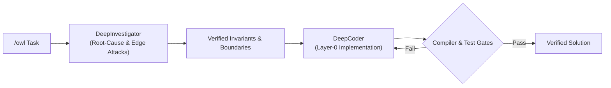
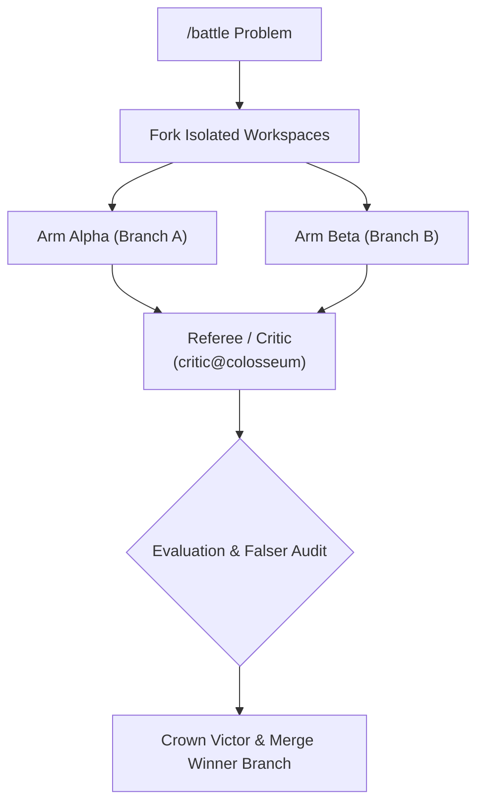

# Antigravity Skills & Extended Tooling

[](https://antigravity.google)
[](LICENSE)
[](https://github.com/MaDxCRaZY/antigravity-skills)

Enterprise-grade skill extensions for **Google Antigravity** (`agy`). This repository surfaces internal agent architectures—including decoupled specialist pipelines, Colosseum adversarial arenas, empirical telemetry benchmarks, and on-demand context compaction—directly as first-class slash commands.

---

## ⚡ Quick Start: 1-Prompt Agentic Installation

If you are currently inside an **Antigravity session**, paste this exact prompt into your chat window:

> **"Install the extension skills from `https://github.com/MaDxCRaZY/antigravity-skills` into my `~/.gemini/config/skills/` directory and activate `/owl`, `/battle`, `/benchmark`, and `/compaction`."**

The agent will clone the repository, deploy each skill to your global configuration, and make the commands available immediately.

---

## 🛠️ Included Slash Commands

| Command | Category | Engine Pipeline | Description |
|---|---|---|---|
| **`/owl`** | Investigation & Code Synthesis | `DeepInvestigator` + `DeepCoder` | Decoupled 2-specialist pipeline that challenges hypotheses, attacks boundary invariants, and iteratively verifies code solutions. |
| **`/battle`** | Adversarial Synthesis | Colosseum Arena (`Workspace='branch'`) | Forks two rival subagents in isolated git branches, pits them against each other, audits flaws with an adversarial referee, and merges the winner. |
| **`/benchmark`** | Telemetry & Performance | `empirical_challenger` | Synthesizes ad-hoc stress-test harnesses, executes them headlessly, and validates speedups with raw hardware telemetry. |
| **`/compaction`** | Memory & Lifecycle | Context Pruner & Artifact Store | Preserves active state into durable artifacts and flushes transient token history to eliminate context exhaustion. |

---

## 🧠 Architectural Deep Dive

### 1. `/owl` — Decoupled Specialist Pipeline
Instead of single-pass guessing or fixing symptom $B$ by blindly patching $A$, `/owl` breaks the task into two decoupled specialists:
* **DeepInvestigator**: Executes full-function call-tree audits, verifies register and pointer lifecycles, and attacks edge cases by asking: *"What if X, Y, Z, F, G occur?"*
* **DeepCoder**: Implements layer-0 fixes against strict compiler gates and ensures zero collateral breakage across downstream consumers.



### 2. `/battle` — Colosseum Battle Mode
When there are multiple architectural paths or competing algorithmic approaches, `/battle` eliminates single-agent bias by running an adversarial tournament:
1. **Parallel Forking**: Two rival subagents work in isolated Git worktrees (`Workspace='branch'`).
2. **Adversarial Audit**: An independent `critic@colosseum` agent attacks edge cases and runs stress-tests against both branches.
3. **Automated Elimination**: The victor is crowned, its branch is fast-forwarded into the main workspace, and the losing branch is eliminated.



### 3. `/benchmark` — Empirical Hardware Telemetry
Replaces guesswork and synthetic claims with raw telemetry:
* Synthesizes isolated, reproducible micro-benchmarks in scratch workspaces.
* Executes headlessly via the terminal sandbox to capture median latency ($p50$), tail latency ($p99$), throughput, and peak memory (RSS).
* Generates a side-by-side empirical comparison matrix.

### 4. `/compaction` — Explicit Context Compaction
Maintains execution momentum during long-running sessions:
* Extracts active symbols, call trees, and ground-truth telemetry into persistent markdown artifacts.
* Flushes verbose terminal logs and intermediate reasoning deltas.
* Emits runtime compaction events to keep token usage within optimal model attention boundaries.

---

## 📦 Manual & CLI Installation

### Windows (PowerShell)
```powershell
git clone https://github.com/MaDxCRaZY/antigravity-skills.git "$env:TEMP\antigravity-skills"
& "$env:TEMP\antigravity-skills\install.ps1"
Remove-Item -Recurse -Force "$env:TEMP\antigravity-skills"
```

### Linux / macOS (Bash)
```bash
git clone https://github.com/MaDxCRaZY/antigravity-skills.git /tmp/antigravity-skills
bash /tmp/antigravity-skills/install.sh
rm -rf /tmp/antigravity-skills
```

### Workspace-Specific Installation
To install these skills strictly for a single repository (without affecting your global profile):
```powershell
# Inside your project root:
.\install.ps1 -LocalWorkspace
```
This deploys the skills into `.agents/skills/`, allowing team members checking out the repo to automatically inherit them.

---

## 🔍 Verification

Once installed, reload your Antigravity IDE window or start a new CLI session. Type `/` in your chat input to verify that the commands appear in the autocompletion menu:
```text
/owl
/battle
/benchmark
/compaction
```

---

## 📄 License
This project is licensed under the [MIT License](LICENSE).
