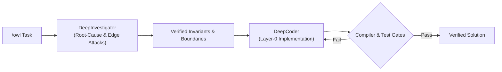
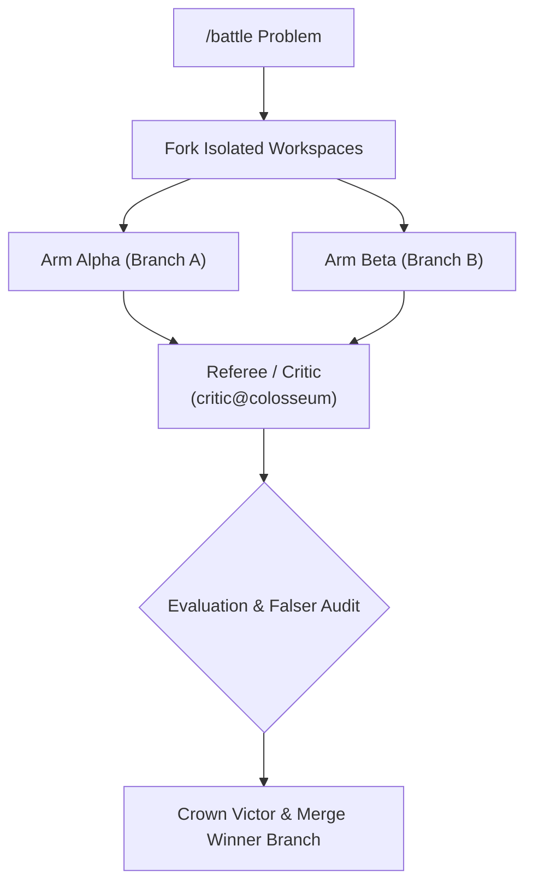

# Antigravity Skills & Extended Tooling

[](https://antigravity.google)
[](LICENSE)
[](https://github.com/MaDxCRaZY/antigravity-skills)

Enterprise-grade skill extensions for **Google Antigravity** (`agy`). This repository surfaces internal agent architectures—including decoupled specialist pipelines, Colosseum adversarial arenas, empirical telemetry benchmarks, and on-demand context compaction—directly as first-class slash commands.

---

## 📑 Quick Navigation

* [⚡ **1-Prompt Agentic Installation**](#quick-start)
* [🛠️ **Included Slash Commands**](#commands)
* [💡 **Real-World Use Cases & Prompt Examples**](#use-cases)
  * [`/owl`: The Heisenbug & Downstream Regressions](#owl-use-case)
  * [`/battle`: High-Stakes Architectural Decisions](#battle-use-case)
  * [`/benchmark`: Verifying Hot-Path Optimization](#benchmark-use-case)
  * [`/compaction`: Marathon Coding Sessions & Context Drift](#compaction-use-case)
* [🧠 **Architectural Deep Dive**](#architecture)
  * [`/owl` Decoupled Pipeline (Flowchart)](#owl-architecture)
  * [`/battle` Colosseum Tournament (Flowchart)](#battle-architecture)
  * [`/benchmark` Telemetry Protocol](#benchmark-architecture)
  * [`/compaction` State Preservation](#compaction-architecture)
* [📦 **Manual & CLI Installation**](#installation)
  * [Windows (PowerShell)](#install-windows)
  * [Linux / macOS (Bash)](#install-nix)
  * [Workspace-Specific Setup](#install-workspace)
* [🔍 **Verification**](#verification)
* [📄 **License**](#license)

---

<a id="quick-start"></a>
## ⚡ Quick Start: 1-Prompt Agentic Installation

If you are currently inside an **Antigravity session**, paste this exact prompt into your chat window:

> **"Install the extension skills from `https://github.com/MaDxCRaZY/antigravity-skills` into my `~/.gemini/config/skills/` directory and activate `/owl`, `/battle`, `/benchmark`, and `/compaction`."**

The agent will clone the repository, deploy each skill to your global configuration, and make the commands available immediately.

---

<a id="commands"></a>
## 🛠️ Included Slash Commands

| Command | Category | Engine Pipeline | Description |
|---|---|---|---|
| **`/owl`** | Investigation & Code Synthesis | `DeepInvestigator` + `DeepCoder` | Decoupled 2-specialist pipeline that challenges hypotheses, attacks boundary invariants, and iteratively verifies code solutions. |
| **`/battle`** | Adversarial Synthesis | Colosseum Arena (`Workspace='branch'`) | Forks two rival subagents in isolated git branches, pits them against each other, audits flaws with an adversarial referee, and merges the winner. |
| **`/benchmark`** | Telemetry & Performance | `empirical_challenger` | Synthesizes ad-hoc stress-test harnesses, executes them headlessly, and validates speedups with raw hardware telemetry. |
| **`/compaction`** | Memory & Lifecycle | Context Pruner & Artifact Store | Preserves active state into durable artifacts and flushes transient token history to eliminate context exhaustion. |

---

<a id="use-cases"></a>
## 💡 Real-World Use Cases & Prompt Examples

<a id="owl-use-case"></a>
### 1. `/owl` — The Heisenbug & Subtle Race Condition
* **When to use:** Intermittent crashes, complex memory corruption, API refactors where downstream callers break easily, or bugs where band-aid fixes create regressions.
* **The Problem with Standard Agents:** A typical coding agent spots a null-pointer crash on line 42 and slaps an `if (!ptr) return;` band-aid over it. This stops the crash, but silently breaks timers, drops events, and leaks memory downstream.
* **How `/owl` Solves It:** Splitting the task forces `DeepInvestigator` to map the object lifecycle, audit downstream consumers, and ask: *"What if connection reset fires while packet processing is queued?"* Once invariants are proven, `DeepCoder` executes the clean structural fix.
* **Example Prompt:**
  ```text
  /owl Investigate why worker threads crash intermittently with SIGSEGV during client disconnects. Audit socket lifecycles and downstream packet queues across the call tree. Formulate and falsify edge-case hypotheses before writing any code.
  ```

---

<a id="battle-use-case"></a>
### 2. `/battle` — High-Stakes Architectural Decisions
* **When to use:** Architectural dilemmas where there is no single consensus answer, or performance-critical subsystems (e.g., Lock-Free Ring Buffer vs. Mutex Queue, Visitor Pattern vs. Match Pattern, Memory-Mapped I/O vs. Buffered Streams).
* **The Problem with Standard Agents:** A single agent picks whatever approach is most prevalent in its training weights and confidently claims it is optimal.
* **How `/battle` Solves It:** Forks your repository into two isolated Git worktrees (`Workspace='branch'`). Competitor Arm Alpha builds Approach A, Competitor Arm Beta builds Approach B. An adversarial referee (`critic@colosseum`) fuzzes and attacks both branches, benchmarks them under load, crowns the winner, and merges it back into your project.
* **Example Prompt:**
  ```text
  /battle We need a high-throughput event logging queue for our game engine.
  Arm Alpha: Implement a lock-free circular ring buffer with atomic CAS.
  Arm Beta: Implement a double-buffering batching queue with condition variables.
  Stress-test both under 100 concurrent worker threads, detect race conditions, and merge the superior implementation.
  ```

---

<a id="benchmark-use-case"></a>
### 3. `/benchmark` — Verifying Hot-Path Optimization
* **When to use:** Hot-path algorithms, SIMD optimizations, database queries, parsers, and deserializers.
* **The Problem with Standard Agents:** LLMs frequently claim: *"I rewrote this loop using std::move and reserve(); it is now 3x faster!"* without ever running code.
* **How `/benchmark` Solves It:** Generates a standalone, executable micro-benchmark harness in a scratch workspace, compiles and executes it headlessly via `run_command`, and outputs a side-by-side empirical telemetry matrix ($p50$/$p99$ latency, throughput, peak memory RSS).
* **Example Prompt:**
  ```text
  /benchmark Optimize parse_json_payload() in parser.cpp for 20MB log payloads. Synthesize an ad-hoc C++ benchmark harness, run it headlessly across 50 iterations, and report raw p50/p99 latency and RSS memory consumption comparing baseline vs candidate.
  ```

---

<a id="compaction-use-case"></a>
### 4. `/compaction` — Marathon Coding Sessions & Context Drift
* **When to use:** Long multi-hour sessions (15+ turns, massive refactors, multi-file migrations) where the conversation becomes sluggish, context costs climb, or the agent begins "forgetting" earlier requirements.
* **The Problem with Standard Agents:** As token limits are approached, models experience context degradation—losing track of edge-case rules or repeating previously failed attempts.
* **How `/compaction` Solves It:** Audits the active session, extracts the durable mental model (active file paths, struct layouts, verified hypotheses, next steps) into persistent markdown artifacts, flushes obsolete compiler errors, and resets active memory.
* **Example Prompt:**
  ```text
  /compaction We just completed the network layer audit. Extract all discovered packet opcodes, state machines, and verified struct layouts into docs/network_state.md, prune transient build logs, and reset the context window for the graphics subsystem.
  ```

---

<a id="architecture"></a>
## 🧠 Architectural Deep Dive

<a id="owl-architecture"></a>
### 1. `/owl` — Decoupled Specialist Pipeline
Instead of single-pass guessing or fixing symptom $B$ by blindly patching $A$, `/owl` breaks the task into two decoupled specialists:
* **DeepInvestigator**: Executes full-function call-tree audits, verifies register and pointer lifecycles, and attacks edge cases by asking: *"What if X, Y, Z, F, G occur?"*
* **DeepCoder**: Implements layer-0 fixes against strict compiler gates and ensures zero collateral breakage across downstream consumers.



<a id="battle-architecture"></a>
### 2. `/battle` — Colosseum Battle Mode
When there are multiple architectural paths or competing algorithmic approaches, `/battle` eliminates single-agent bias by running an adversarial tournament:
1. **Parallel Forking**: Two rival subagents work in isolated Git worktrees (`Workspace='branch'`).
2. **Adversarial Audit**: An independent `critic@colosseum` agent attacks edge cases and runs stress-tests against both branches.
3. **Automated Elimination**: The victor is crowned, its branch is fast-forwarded into the main workspace, and the losing branch is eliminated.



<a id="benchmark-architecture"></a>
### 3. `/benchmark` — Empirical Hardware Telemetry
Replaces guesswork and synthetic claims with raw telemetry:
* Synthesizes isolated, reproducible micro-benchmarks in scratch workspaces.
* Executes headlessly via the terminal sandbox to capture median latency ($p50$), tail latency ($p99$), throughput, and peak memory (RSS).
* Generates a side-by-side empirical comparison matrix.

<a id="compaction-architecture"></a>
### 4. `/compaction` — Explicit Context Compaction
Maintains execution momentum during long-running sessions:
* Extracts active symbols, call trees, and ground-truth telemetry into persistent markdown artifacts.
* Flushes verbose terminal logs and intermediate reasoning deltas.
* Emits runtime compaction events to keep token usage within optimal model attention boundaries.

---

<a id="installation"></a>
## 📦 Manual & CLI Installation

<a id="install-windows"></a>
### Windows (PowerShell)
```powershell
git clone https://github.com/MaDxCRaZY/antigravity-skills.git "$env:TEMP\antigravity-skills"
& "$env:TEMP\antigravity-skills\install.ps1"
Remove-Item -Recurse -Force "$env:TEMP\antigravity-skills"
```

<a id="install-nix"></a>
### Linux / macOS (Bash)
```bash
git clone https://github.com/MaDxCRaZY/antigravity-skills.git /tmp/antigravity-skills
bash /tmp/antigravity-skills/install.sh
rm -rf /tmp/antigravity-skills
```

<a id="install-workspace"></a>
### Workspace-Specific Installation
To install these skills strictly for a single repository (without affecting your global profile):
```powershell
# Inside your project root:
.\install.ps1 -LocalWorkspace
```
This deploys the skills into `.agents/skills/`, allowing team members checking out the repo to automatically inherit them.

---

<a id="verification"></a>
## 🔍 Verification

Once installed, reload your Antigravity IDE window or start a new CLI session. Type `/` in your chat input to verify that the commands appear in the autocompletion menu:
```text
/owl
/battle
/benchmark
/compaction
```

---

<a id="license"></a>
## 📄 License
This project is licensed under the [MIT License](LICENSE).
